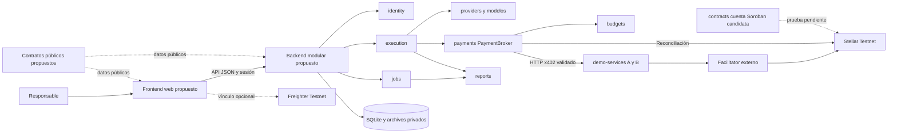

# Arquitectura del MVP

Estado: arquitectura propuesta, sin aplicaciones ni monorepositorio implementados. Se retiró el código anterior; entrega vigente de requerimientos y frontend en Figma. Revisión: 10 de octubre de 2026. El [alcance crítico y los mínimos](scope-and-critical-review.md) distinguen P0 (prototipo), P1 (revisión útil) y P2 (Testnet integrado).

## Alcance y criterio de diseño

AgentNexo coordina una revisión estática de hasta tres archivos JavaScript/TypeScript, 1.000 líneas y 256 KiB totales en UTF-8. Produce observaciones y casos propuestos. En la variante de dos roles, el analista puede consultar A y el diseñador de pruebas puede consultar B; un coordinador determinista reúne sus salidas. No se ejecuta el código recibido, no se instalan sus dependencias y los casos propuestos no se presentan como pruebas ejecutadas.

La web se orienta a computadores y se adapta a pantallas menores. El usuario define condiciones, autoriza una versión de la política, observa ejecución y gastos y descarga un informe. Quedan fuera aplicaciones móviles nativas, marketplace abierto, Mainnet, token propio, suscripciones obligatorias y múltiples sectores implementados.

Para una fase futura se propone un monolito modular en un monorepositorio. Separar aplicaciones y responsabilidades permite trabajar de forma independiente sin añadir microservicios, un bus de eventos ni una cola distribuida. A/B tienen un proceso de demostración separado porque representan una frontera HTTP de proveedor.

El sistema es un flujo acotado. P1 comienza con una tarea `reviewer` que produce hallazgos y casos; la variante de dos roles solo se promueve si la evaluación demuestra beneficio. El modo queda fijado en la política aceptada. A/B son capacidades opcionales restringidas a su fixture público: no toda revisión necesita compras y pagar no equivale a obtener un informe de calidad. Las compras forzadas A → B pertenecen al ensayo financiero, no a la política general del producto.

## Componentes

Este diagrama representa la arquitectura objetivo P1/P2. P0 es diseño en Figma; no existen carpetas ejecutables ni conexiones a estos servicios. La cuenta C y el vínculo de wallet son condicionales y no bloquean P1.

El navegador nunca importa driver SQL, firmante o configuración secreta. La wallet no sustituye la sesión de aplicación. El usuario autoriza; el modelo solo produce solicitudes de herramientas dentro de capacidades ya asignadas.

## Módulos del backend

Se materializan al implementar cada funcionalidad, sin directorios vacíos. Cada módulo expone su API interna en `index.ts`; otros módulos no acceden a sus repositorios ni tablas directamente.

| Módulo | Propósito y datos propios | Entradas y salidas | Dependencias permitidas | Exclusiones |
| --- | --- | --- | --- | --- |
| `identity` | Responsable, sesiones, recuperación, preferencias y vínculo comprobado de wallet | Credencial/desafío; contexto autenticado de servidor | Configuración, sesiones y verificador de firma | Registro público, perfiles y autoridad de compra |
| `jobs` | Objetivo, archivos, criterios, versión autorizada y estado | Crear/autorizar/cancelar; detalle de trabajo | Contexto de identidad, APIs de budgets/reports y almacenamiento propio | Importar execution, llamar modelos o firmar |
| `execution` | Una o dos asignaciones fijas, tareas, intentos y leases | Snapshot autorizado; salidas estructuradas y estados | APIs de providers, payments, budgets y reports | Importar jobs, alterar políticas, SQL ajeno o secretos en prompts |
| `providers` | Catálogo A/B, orígenes permitidos y configuración de modelo | Petición tipada; resultado validado/consumo | HTTP acotado, adaptadores y budgets para modelos | URLs decididas por modelos, aprobar pagos x402 |
| `budgets` | Límites, cupos, reservas y asientos | Reservar/confirmar/liberar; importes por categoría | Persistencia transaccional y reloj | Firma, HTTP o sumar monedas distintas |
| `payments` | Operaciones x402, evidencias y conciliación | Solicitud y 402 validados; pago/rechazo/incertidumbre | budgets, catálogo providers, signer y SDKs | Decidir permisos del agente o calidad de contenido |
| `reports` | Versiones de informe, citas y estado de entrega | Snapshots explícitos de encargo, salidas y gastos; Markdown/JSON | Validadores puros y almacenamiento propio | Importar jobs/execution/payments, declarar pruebas ejecutadas o modificar gastos |

Compartir SQLite no implica compartir acceso indiscriminado a sus tablas. `app/` construye Express, repositorios, clientes y coordinador por composición. `config/` valida variables al inicio. `shared/` solo contiene errores comunes, reloj, IDs y conexión transaccional; una utilidad con un consumidor permanece en su módulo.

`app/workflows` compone admisión, cancelación y publicación: obtiene el snapshot por `jobs`, llama `execution` y aplica transiciones mediante APIs de cada propietario. El despachador persistente usa esa misma composición. No se introduce un bus. Los módulos no se llaman mutuamente para reconstruir el encargo; `reports` recibe datos versionados completos. La publicación registra las versiones usadas y una revisión nueva cuando llega evidencia posterior. Comprobar el grafo de imports si se autoriza implementar P1; el diseño no acredita estas fronteras.

## Módulos del frontend

| Módulo | Datos y entradas | Salidas | Dependencias permitidas | Exclusiones |
| --- | --- | --- | --- | --- |
| `work-orders` | Borrador, objetivo, archivos y política | Crear trabajo y autorización explícita | API, controles accesibles y DTO | Determinar saldo o permisos reales |
| `execution` | Proyección de progreso y fallos | Cancelación y actualización de vista | API y componentes compartidos | Orquestar agentes en navegador |
| `spending` | Estimados, reservas, confirmados y recibos | Desglose por categoría/activo | DTO de dinero exacto y formato | Sumar USD/USDC/XLM o decidir cupos |
| `reports` | Informe y limitaciones | Descarga y navegación a hallazgos | API autorizada y controles de lectura | Ejecutar código o HTML recibido |
| `wallet` | Conexión, red y desafío inicial | Prueba firmada y error de wallet | Freighter y API pública | Claves privadas o firmas por llamada |
| Acceso y recuperación | Correo, contraseña y estados de recuperación | Solicitar sesión/enlace/restablecimiento | Contratos de identidad | Verificar secretos o revelar cuentas |
| Inicio y notificaciones | Revisiones, pendientes y mensajes propios | Abrir origen y cambiar lectura | Proyecciones autorizadas | Alterar ejecución o pagos |
| Ajustes | Preferencias y datos propios | Solicitar guardado o salir | API propia | Administración pública o claves |

`app/` contiene navegación y composición. `shared/` contiene cliente HTTP, controles y formatos realmente reutilizados. La autenticación necesita acceso y contexto de sesión; no un CRUD de usuarios ni un dashboard genérico.

## Dominio, casos de uso e infraestructura

En `budgets` y `payments` compensa separar `domain/` (dinero y transiciones), `application/` (reservar y conciliar) e `infrastructure/` (SQLite, SDK y firmante). Los handlers HTTP validan el DTO y llaman al caso de uso. `jobs` y `reports` empiezan con archivos cohesivos: se dividen cuando exista una responsabilidad concreta.

| Principio SOLID | Decisión verificable |
| --- | --- |
| Responsabilidad única | execution programa; budgets conserva saldos; payments controla el flujo externo; reports compone la entrega. |
| Extensión | Otro proveedor implementa el puerto pequeño `ModelGateway`; no modifica la aritmética financiera. |
| Sustitución | Los adaptadores conservan timeout, esquema de salida y consumo incierto; un mock no convierte un timeout en costo cero. |
| Segregación | Puertos `ReserveBudget`, `ReadSpending`, `Signer` y `ModelGateway`; no un servicio universal con claves y SQL. |
| Inversión | Los casos de uso reciben reloj, repositorio y adaptadores; no crean clientes globales ni importan Express. |

No se añade contenedor de inyección, repositorio genérico, event sourcing ni CQRS. Las interfaces se introducen en fronteras de IO/autoridad y puntos de prueba útiles; las funciones puras internas no requieren una interfaz por función.

## Fuentes de verdad y cierre

SQLite es la fuente de autorización de aplicación, reservas, tareas e identidad. Stellar determina liquidaciones y saldos on-chain. Un recibo del proveedor o un HTTP 200 no sustituye esa verificación. La base guarda el resultado reconciliado, procedencia y fecha. Véanse [Datos](data-model.md) y [Pagos](payments-and-budget.md).

Ejecución, situación financiera y entrega son estados independientes. Cancelar o terminar no borra una reserva incierta ni revierte una transferencia. Una ampliación genera una nueva versión autorizada; las compras existentes conservan su versión de origen.

## Decisiones y dependencias

Dirección futura: npm workspaces; React/Vite; Express; módulos por funcionalidad; SQLite local de instancia única; contratos públicos sin servidor. No hay dependencias instaladas ni fuentes ejecutables. [Herramientas y fuentes](toolchain-and-sources.md) documenta versiones/alternativas; [Monorepositorio](monorepo.md), la organización propuesta.

Pendientes: integración C-account/x402, proveedor/modelo, cotas de tokens/facturación, driver probado, credenciales demo y despliegue. PostgreSQL será la alternativa cuando aparezcan múltiples instancias escritoras o almacenamiento compartido. Redis, MongoDB y Neo4j no resuelven necesidades demostradas del MVP.

Se sigue el documento de ingeniería suministrado: división por aplicación y funcionalidades, sin copiar sus módulos ilustrativos. `contracts/` usará Cargo en su fase; npm no compila Rust.

## Separación de contextos de autorización

La revisión estándar acepta archivos privados y reserva únicamente presupuesto de modelo, USD 1,00. A/B y gasto externo Testnet no están autorizados: límites USDC/XLM cero. Este contexto no puede promoverse automáticamente al financiero por una sugerencia de agente o un 402.

DEMO-01 es un caso público separado de pricing.ts fijo, con identidad y aceptación Testnet propias. Modelo USD 1,00; compras 0,06 USDC Testnet; red 0,10 XLM Testnet. Sus proyecciones de autorización/gastos/actividad/resultado no se mezclan con los trabajos privados. Las unidades monetarias son independientes.

La presentación conserva identidad y estado entre pestañas de revisiones completadas. Variables nativas del diseño no constituyen fuentes de verdad de sesión, avisos, borradores o presupuesto del producto futuro.
