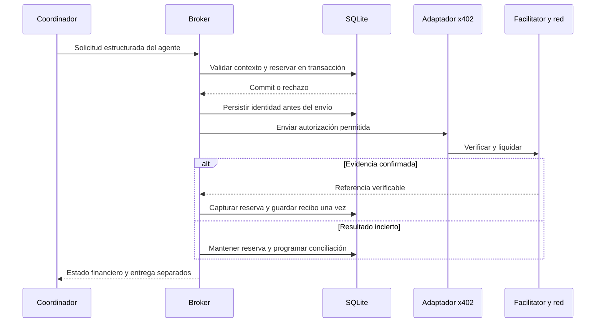

# Backend, API y coordinación de agentes

**Estado:** contrato de implementación del MVP, revisado el 9 de octubre de 2026. Los endpoints y las máquinas de estado de este documento todavía no existen como aplicación. La propuesta futura separa frontend y backend; el repositorio actual no contiene aplicaciones ni exige microservicios. Véanse [arquitectura](architecture.md), [datos](data-model.md) y [pagos](payments-and-budget.md).

## Módulos y dependencias

El backend recomendado es Node.js LTS, TypeScript y Express. Un proceso contiene API, despachador persistente y conciliador. La web futura consumiría HTTP y contratos públicos portables; nunca importa repositorios, secrets, SDK de firma ni módulos del backend. Las capas se introducen donde protegen una frontera real: controlador valida/transfiere, caso de uso decide, repositorio/adaptador persiste o llama al exterior.

| Módulo | Posee y produce | Dependencias permitidas y exclusiones |
| --- | --- | --- |
| `identity` | Responsable demo, sesión, contexto autorizado y pruebas de posesión de wallet cuando se habiliten. | Repositorio de sesión/desafíos y verificador seguro. No compra ni infiere identidad desde una wallet conectada. |
| `jobs` | Objetivo, archivos, paquete, criterios y estado general. | Contexto de identidad, almacenamiento privado y budgets/reports. No importa execution ni ejecuta archivos. |
| `budgets` | Política versionada, aceptación, bolsas, límites, reservas y consumos. | Repositorio transaccional; aplica invariantes exactas. No realiza HTTP ni firma bajo la transacción. |
| `execution` | Variante fijada, tareas, intentos, cancelación, eventos y consolidación. | Snapshot del encargo; APIs de budgets/providers/payments/reports. No importa jobs ni escribe tablas ajenas. |
| `providers` | Catálogo y revisiones; adaptador del modelo; herramientas A/B y validación de sus salidas. | Configuración inyectada; budgets para reservar/conciliar inferencias. No acepta destinos libres del modelo. |
| `payments` | PaymentBroker, preparación de autorización, envío y conciliación x402/Stellar. | budgets, consulta de proveedor permitido y adaptador de firmante/facilitator. No delega claves ni límites al agente. |
| `reports` | Informe estructurado y render descargable, hallazgos, limitaciones y recibos referenciados. | Datos versionados recibidos como argumentos y almacenamiento propio. No consulta jobs/execution/payments ni transforma conjeturas en defectos confirmados. |

Usar composición al arrancar la aplicación para inyectar reloj, repositorios, modelo y firmante; permite simular tiempo y fallos sin pagar. El contrato del broker no depende del SDK concreto. No crear interfaces para cada clase, herencia de agentes ni un módulo `shared` que acabe conteniendo reglas de negocio. `shared` se limita a transporte de errores, contexto de petición y utilidades puras usadas realmente por varios módulos. La transacción de budgets es el dueño de la reserva incluso cuando payments inicia el caso de uso.

## Identidad y autorización

La demo tendrá **un responsable preconfigurado autenticado**, con credencial entregada fuera del repositorio y verificador de contraseña seguro, sin registro abierto ni administración de usuarios. Login crea una sesión opaca del servidor; cookie `HttpOnly`, `Secure` en HTTPS y `SameSite=Lax`, con rotación tras login y revocación al salir. Inactividad 30 minutos, vigencia absoluta 12 horas. Desarrollo sin HTTPS queda limitado a loopback. La recuperación autoservicio por correo es un requisito del responsable preconfigurado: token aleatorio, hash seguro, 30 min de vigencia propuestos y uso único; cambiar la credencial revoca sesiones y exige nuevo acceso. Contraseña de 15–128 caracteres. El correo se verifica al preconfigurar. Antes de servicio multiusuario elegir OIDC y aprovisionamiento de tenants; ninguna de estas funciones está implementada.

Mutaciones autenticadas —incluidos POST, PUT, PATCH y DELETE— exigen token CSRF ligado a sesión y comprobación de `Origin`; login exige origen permitido y protección contra login CSRF. Desarrollo usa proxy de Vite hacia la API; producción propone un origen público y rutas `/api`, aunque ambos builds sean independientes. No abrir CORS con credenciales a `*`. La wallet configura/autoriza fondos de Testnet cuando corresponda: conexión de Freighter y sesión del usuario tienen responsabilidades distintas. Una firma financiera no crea una sesión web.

Toda lectura/mutación parte del tenant de la sesión; no aceptar `tenantId`, `ownerId`, `agentId` arbitrario ni parámetros de destinatario para cambiar pertenencia. Para IDs ajenos se devuelve 404. Los roles de agentes se vinculan desde el contexto de ejecución persistido, no desde texto generado. [Datos y enforcement](data-model.md) define FKs compuestas y filtros de repositorio.

## Contrato HTTP v1

Base `/api/v1`, JSON UTF-8 y fechas ISO 8601 UTC. IDs opacos; errores estables `code`. Contratos compartidos contienen DTO, enums y validación serializable; no contienen entidades SQL o SDKs. Tipos TypeScript no sustituyen validación en runtime. Lista de trabajos paginada por cursor opaco ligado al tenant, `limit` 1–50, valor inicial 20. Respuestas privadas usan `Cache-Control: no-store`.

Cada mutación de negocio exige `Idempotency-Key` opaca, de 16–128 caracteres ASCII seguros; se vincula a tenant, actor, método y ruta. Mismo cuerpo canónico devuelve el recurso anterior; cuerpo distinto, 409. Mutaciones sobre borradores/políticas exigen `If-Match` de `version`; 412 ante edición obsoleta. Ningún GET firma, cobra, inicia inferencia o cambia límites.

| Método y ruta | Entrada y precondición | Salida y errores específicos |
| --- | --- | --- |
| `POST /session` | `{email,password}`; responsable preconfigurado, origen admitido; límite de intentos por origen/IP/correo. | 200 `{principal:{id},csrfToken,expiresAt}` + cookie; 401 credencial inválida genérica; 429. No devuelve hash/credencial. |
| `GET /session` | Cookie vigente. | 200 contexto propio y CSRF; 401. |
| `DELETE /session` | Cookie y CSRF. | 204 y revocación; se puede repetir sin restaurar sesión. |
| `POST /password/recovery` | Correo, origen permitido y límites de intentos. | 202 genérico sin revelar existencia. El enlace solo se envía al correo preconfigurado; no se devuelve token. |
| `POST /password/reset` | Token y contraseña 15–128 caracteres; origen permitido. | 204 tras consumo/cambio atómicos y revocación de sesiones. 400 enlace inválido/usado/caducado; 422 formato local; sin sesión automática. |
| `POST /wallet/challenges` | Flujo condicional habilitado, sesión/CSRF/idempotencia y `{publicKey}` de una cuenta G; red y dominio fijados por servidor. | 201 `{challengeId,scheme,message,expiresAt}` con vigencia de 10 min; 409 `WALLET_PROOF_DISABLED`; 422 cuenta/esquema no admitidos. No inicia sesión ni autoriza fondos. |
| `POST /wallet/bindings` | Sesión/CSRF/idempotencia; `{challengeId,signature}`; desafío propio, de la misma sesión y no consumido; firma codificada hasta 16 KiB, validada según esquema habilitado. | 201 `{bindingId,publicKey,network,verifiedAt}`; 404 desafío ajeno/inexistente; 409 `CHALLENGE_USED`; 422 firma inválida, contexto distinto o expiración. Consumo de nonce e inserción del vínculo atómicos. |
| `GET /providers` | Sesión. | 200 proveedores/configuraciones públicas admitidas, revisión, capacidad/precio y `ready`; no secretos ni URL de administración. |
| `GET /notifications` | Sesión, cursor propio y filtro de lectura. | 200 eventos públicos propios; sin prompts o secretos. |
| `PATCH /notifications/:id` | Sesión/CSRF/idempotencia; marcar lectura de notificación propia. | 200 estado de lectura, sin cambiar negocio; 404 ajena. |
| `POST /notifications/read-all` | Sesión/CSRF/idempotencia; límite/cursor del conjunto visible. | 200 marcado de mensajes existentes; no los llegados después. |
| `GET /preferences` | Sesión. | 200 preferencias propias no sensibles. |
| `PATCH /preferences` | Sesión/CSRF/idempotencia; campos públicos permitidos. | 200 preferencias guardadas; sin modificar otros usuarios. |
| `POST /jobs` | Título, objetivo, criterios y 1–3 archivos de texto JS/TS; idempotencia. | 201 `Job` en `draft`, `version`, `Location`; 413/415/422 por contenido/límites. |
| `GET /jobs` | Sesión, cursor/limit opcionales. | 200 `{items,nextCursor}` solo del responsable. |
| `GET /jobs/:jobId` | Sesión y ownership. | 200 `JobView` con tareas, estado y enlaces propios; `ETag`; 404. |
| `PATCH /jobs/:jobId` | Sesión/CSRF/idempotencia, `If-Match`; uno o más de `{title,objective,acceptanceCriteria,files}`; solo `draft/awaiting_authorization`, sin ejecución admitida ni operaciones/reservas/consumos. | 200 `Job` en `draft` con nueva `version`/`inputDigest`; invalida política y aceptación vigentes conservando historial; 409 `INPUT_LOCKED`; 412 versión obsoleta; 413/415/422 entrada inválida. `files`, si se incluye, sustituye la lista completa. |
| `PUT /jobs/:jobId/policy` | Límites por bolsa/agente, proveedores por ID/revisión, plazo; `If-Match`; draft/awaiting_authorization/paused. | 200 snapshot nuevo, digest, versión y estado `awaiting_authorization`; 409 si hay ejecución activa incompatible; 422 límites/destinos inválidos. No amplía una versión autorizada en sitio. |
| `GET /jobs/:jobId/policy` | Ownership. | 200 snapshot completo normalizado, digest, estado de aceptación y modalidad de control. |
| `POST /jobs/:jobId/authorizations` | `{policyVersion,policyDigest,accept:true}`; ownership, CSRF, idempotencia; firma adicional solo si el flujo financiero elegido la requiere. | 201 aceptación inmutable; 409 versión cambiada o configuración financiera no lista; 422 expiración. No inicia una compra. |
| `POST /jobs/:jobId/run` | `{authorizationId}` propio, válido y coincidente; idempotencia. | 202 `{jobId,state:"queued"}`; 409 `NOT_READY/INVALID_STATE`; ninguna ejecución si modelo/firma/activo no están configurados. |
| `POST /jobs/:jobId/cancel` | `{reason?}` hasta 300 caracteres; idempotencia y ownership. | 202 `cancel_requested`, o 200 estado terminal existente. No promete reversión de pagos enviados. |
| `POST /jobs/:jobId/resume` | `{authorizationId}`; job `paused`; política vigente y límites aún válidos; idempotencia. | 202 `queued`; 409 si hay operación crítica incierta o estado incompatible. No reinicia cargos ni contadores. |
| `GET /jobs/:jobId/events?after=...` | Cursor entero no negativo propio, límite máximo 100. | 200 eventos sanitizados ordenados y cursor; polling inicial cada 2 s, backoff cuando inactivo. |
| `GET /jobs/:jobId/budget` | Ownership. | 200 bolsas con `authorized/reserved/confirmed/available/deficit`, escala, moneda y `financialState`; no total multimoneda. |
| `GET /jobs/:jobId/payments` | Ownership. | 200 operaciones x402 con estados financiero/de entrega, importes y recibos públicos verificables; firmas reutilizables excluidas. |
| `GET /jobs/:jobId/report` | Ownership y salida producida. | 200 `Report`; 409 `REPORT_NOT_READY`; informe parcial permitido e identificado. |
| `GET /jobs/:jobId/report/download` | Ownership, informe existente. | 200 Markdown como attachment y `nosniff`; 409/410 si no está listo o fue eliminado. |
| `DELETE /jobs/:jobId` | Borrador propio, CSRF/idempotencia, If-Match y ausencia de ejecución/operaciones/reservas/consumos. | 204 borrador eliminado; 409 si hay compromisos, 412 versión obsoleta. |
| `POST /jobs/:jobId/archive` | Ownership, CSRF/idempotencia y estado terminal de ejecución. | 200 archivado, conservando contenido/contabilidad y acceso a conciliación; 409 ejecución activa. |
| `POST /jobs/:jobId/unarchive` | Ownership, CSRF/idempotencia. | 200 restaurado al listado, sin reiniciar ejecución. |
| `DELETE /jobs/:jobId/content` | Ownership, CSRF, idempotencia, ejecución detenida y política de retención. | 202 retiro de contenido; metadatos mínimos conservados; 409 si entrada en uso. No es la eliminación directa del borrador ni borra blockchain. |

Validaciones de entrada: título 3–100 caracteres, objetivo 20–2.000 caracteres, 1–10 criterios de hasta 500 caracteres, archivos `.js/.ts` UTF-8 sin NUL, 1.000 líneas totales (LF normalizado), 256 KiB totales y nombres de presentación hasta 120 caracteres. Rechazar rutas absolutas, segmentos `..`, archivos comprimidos, URLs a clonar y extensiones fuera de lista. Límite HTTP JSON 512 KiB. Estos son topes iniciales de producto, no medidas de calidad del análisis.

PATCH vuelve a validar el estado combinado, incluidos archivos conservados; rechaza campos desconocidos como estado, tenant, propietario o límites financieros. La edición, invalidación de política y verificación de que no comenzó una ejecución ocurren en una transacción. Cambiar entradas jamás reutiliza la aceptación de su digest anterior. Un trabajo encolado, en ejecución, pausado tras iniciarse o con alguna operación no permite editar entradas; otro alcance requiere otro trabajo.

La prueba de wallet es **condicional y separada del pago**. El servidor construye un mensaje de propósito exclusivo `AgentNexo wallet binding`, versionado, con nonce criptográfico de 32 bytes, identidad opaca de tenant/principal/sesión, clave pública, dominio canónico, red `stellar:testnet`, creación y expiración de 10 minutos. Dominio y red salen de configuración confiable, no de `Host` ni del cuerpo del cliente. La firma se verifica sobre los bytes exactos y con el esquema compatible con Freighter demostrado en el spike; hasta entonces el flujo responde `WALLET_PROOF_DISABLED`. No se acepta una firma sobre texto libre ni una transacción arbitraria. El esquema y su verificador no se seleccionan desde la respuesta del cliente.

Antes de crear el vínculo se revalidan sesión, contexto, expiración y consumo del nonce en la misma transacción; dos verificaciones concurrentes no consumen dos veces el desafío. La repetición con la misma clave idempotente y payload devuelve el vínculo original; un replay con otra clave se rechaza. Cambiar cuenta o red exige otro desafío. Una cuenta C requiere su propio flujo probado; no se verifica como una clave Ed25519 G. Esta vinculación no delega fondos, no acepta una política y no firma una compra; la autorización financiera mantiene su flujo independiente.

Ejemplo abreviado de creación, con IDs ilustrativos emitidos por servidor:

```json
{
  "objective": "Revisar validación de cantidades y casos límite del módulo",
  "acceptanceCriteria": ["Hallazgos con archivo y líneas", "Casos de prueba propuestos"],
  "files": [{"name": "quantity.ts", "language": "typescript", "content": "export const valid = (n: number) => n > 0;\n"}]
}
```

La política referencia `providerId` y `providerRevision`, no una URL/destinatario enviados por el navegador. Cada bolsa declara `category`, `currencyKey`, `scale`, `limitMinor` y límites de agentes; cada permiso declara proveedor y `maxOperationMinor`. El backend devuelve la expansión exacta —URL/método/red/token/destino/modelo/tarifas— para que el responsable acepte el digest. Los valores monetarios son cadenas de enteros. Una ampliación conserva cargos/reservas, genera nueva revisión y requiere aceptación; jamás convierte tokens Testnet en USD.

El snapshot aceptado incluye el `inputDigest` vigente de objetivo, criterios y archivos. `run` vuelve a comparar ese digest y la versión de política antes de admitir tareas; una aceptación histórica invalidada por PATCH nunca sirve para iniciar.

Para cada bolsa, el backend calcula `saldoNeto = authorized − confirmed − reserved`; serializa `available = max(0, saldoNeto)` y `deficit = max(0, −saldoNeto)` como cadenas de enteros no negativos en su escala. Ante una factura real excesiva conserva `confirmed` completo, expone `deficit` y bloquea nuevos consumos; no envía un `available` negativo ni oculta el cargo.

Ejemplo de vista de presupuesto de una bolsa USD (los activos Testnet tienen su propia entrada):

```json
{
  "jobId": "job_demo_01",
  "financialState": "pending",
  "buckets": [{
    "category": "models", "currencyKey": "USD", "scale": 9,
    "authorized": "1000000000", "reserved": "200000000", "confirmed": "100000000",
    "available": "700000000", "deficit": "0"
  }]
}
```

Forma única de error, sin stack, SQL, prompt, secreto ni respuesta cruda del proveedor:

```json
{
  "error": {
    "code": "POLICY_CHANGED",
    "message": "Las condiciones cambiaron; revisa la versión vigente.",
    "requestId": "req_demo_01",
    "details": [{"field": "policyVersion", "reason": "stale"}]
  }
}
```

Mapa común: 400 JSON/query inválidos; 401 sesión; 403 CSRF/origen o acción sin permiso; 404 recurso ajeno/inexistente; 409 estado, idempotencia o política; 412 versión obsoleta; 413 tamaño; 415 formato; 422 dato semántico; 429 límite; 503 dependencia o almacenamiento no disponible. `Retry-After` solo acompaña rechazos reintentables. Un rechazo de presupuesto de una herramienta interna se registra como `BUDGET_EXCEEDED`, se muestra en eventos y no se oculta como 500. El HTTP 402 de A/B expresa una oferta de pago, no una autorización del usuario.

## Roles, herramientas y salidas

Coordinador determinista y consolidación sin otro modelo. La base de P1 es `single-pass`: una tarea `reviewer` produce hallazgos y casos en una salida estructurada, sin herramientas pagadas. La variante `two-role` separa analista y diseñador de pruebas y solo se habilita para producto si supera la evaluación; P2 puede usarla como ensayo identificado. El modo se fija en configuración y en el snapshot aceptado, nunca por instrucción del modelo. No se permite cambiarlo durante una ejecución, crear roles ni compartir memoria entre clientes. `app/workflows` coordina admisión y transiciones entre jobs/execution, evitando imports circulares; los módulos conservan propiedad de sus tablas.

Se trata de un flujo acotado, cuya ventaja sobre una sola llamada todavía debe demostrarse con la [evaluación mínima](scope-and-critical-review.md). No se añade un planificador LLM. El modelo puede decidir si una herramienta permitida aporta evidencia; toda compra requiere necesidad registrada, entrada soportada y validación del broker. Un recurso sin soporte produce `TOOL_NOT_APPLICABLE` antes de reserva, firma o envío. Para toda revisión estándar con archivos privados, A/B quedan inhabilitados y USDC/XLM no autorizados en cero, incluso si nombre o digest coinciden con el fixture. La coincidencia de contenido no cambia el contexto ni concede autorización. DEMO-01 usa únicamente pricing.ts público fijo y una política Testnet independiente.

| Rol | Herramientas permitidas | Salida estructurada |
| --- | --- | --- |
| `reviewer` (`single-pass`) | Entrada propia y resultados de reglas locales; ninguna herramienta pagada. | Hallazgos y casos propuestos con los mismos esquemas de las dos filas siguientes. |
| `analyst` | Lectura de las entradas propias; `requestStaticAnalysis` para A. | Hallazgos con `fileId`, líneas válidas, severidad, explicación, evidencia, incertidumbre y recomendación. |
| `test-designer` | Lectura de las entradas propias; `requestTestCatalogue` para B. | Casos propuestos con precondición, entrada, resultado esperado y referencia de archivo; se indica que no se ejecutaron. |

El modelo entrega `{inputDigest,parameters}` limitado al ejemplo soportado. El coordinador añade `operationKey` estable para la compra lógica y el servidor resuelve job, agente, proveedor y contexto autorizado; valida todo contra el snapshot. La identidad de compra incorpora herramienta y entrada, y el máximo de una compra por servicio/rol se comprueba transaccionalmente. El modelo no puede escoger una nueva clave para repetir un cobro, ni pasar una URL, shell, clave, destino, presupuesto o nuevo rol. No existe herramienta genérica de HTTP, instalación, ejecución de código, lectura del disco o modificación de repositorio. Texto del cliente y de A/B se trata como datos no confiables, sin convertir instrucciones incrustadas en acciones.

Contrato de A/B: rutas separadas `POST /v1/static-analysis` y `POST /v1/test-catalogue` en el servicio demostrativo; aceptan `fixtureId`, `inputDigest` y parámetros acotados para el ejemplo público admitido, y devuelven respectivamente métricas/observaciones o casos parametrizados. Se valida el digest del fixture y se rechaza entrada desconocida. Respuestas JSON hasta 128 KiB y esquema versionado. Ambas tienen destinatarios Testnet distintos. Para el MVP no reciben repositorios, descargan dependencias ni ejecutan tests. Solicitudes sin prueba válida reciben el desafío x402 configurado; la identidad de recurso/solicitud permite recuperar una entrega ya pagada según el adaptador demostrado.

Un fallo de A se declara como falta de contraste externo. Si B se rechaza, el diseñador propone casos desde la entrada original y marca que no obtuvo catálogo. El informe no afirma cobertura medida, tests aprobados ni defectos confirmados sin evidencia. `reports` comprueba referencias de líneas, marca duplicados y combina salidas de forma determinista; una salida inválida del modelo no se publica como válida.

La ausencia de compra no falla por sí sola una tarea: si una capacidad no era necesaria, se registra `not_requested` con motivo y el entregable puede estar completo. Si una contribución solicitada falta, el informe explica el alcance perdido. Pagar ambos proveedores tampoco basta para completar el trabajo: las salidas de la variante autorizada deben superar esquema, referencias y criterios de entrega. El escenario sintético del frontend simplifica esta relación y no es una implementación de la máquina de estados de producción.

## Estados y límites de ejecución

Trabajo: `draft → awaiting_authorization → queued → running → completed | partial | failed`. Desde ejecución se puede pasar a `paused` por recursos/configuración, o `cancel_requested → cancelled`; un `queued` cancelado no empieza. `paused → queued` requiere autorización vigente. `completed` significa entregable consolidado, no cierre financiero. Un campo separado `financialState=open|pending|closed|attention` mantiene visible una compra incierta o sobrecosto incluso en trabajo terminal.

Tarea: `pending → running → succeeded | failed | cancelled`, con `running → waiting_external` mientras espera y `running → retry_wait → pending` solo en errores reintentables. El despachador registra reclamo, intento e identidad antes de salir a la red. La consolidación espera las tareas fijadas por la variante (una o dos); un resultado ausente produce salida parcial y limitaciones claras. Cada criterio solicitado se marca `sustentado/no_sustentado/no_evaluado` con referencias; tener JSON válido o pagar no demuestra cumplimiento.

| Límite inicial recomendado | Aplicación |
| --- | --- |
| 2 tareas de agente simultáneas por trabajo; 2 llamadas externas activas globales en la instancia demo | Semáforo del despachador; no contar solo mensajes de UI. La cola se persiste y el plazo sigue avanzando. |
| 4 llamadas de modelo por agente, incluido como máximo 1 reintento total por agente | Se contabiliza cada solicitud enviada, aunque falle o sea un reintento de formato. No crear un bucle independiente por error. |
| 1 compra lógica por servicio/rol | Reintento de transporte conserva identidad; no crea otra compra. |
| Tokens de entrada/salida y reserva por modelo | Deben fijarse al elegir modelo y precio antes de autorizar. Si faltan, `run` responde `NOT_READY`. Incluyen contexto de herramientas y tokens facturables de razonamiento cuando corresponda. |
| 10 minutos por trabajo | Deadline absoluto persistido desde el inicio aceptado; no se reinicia al reanudar. Ampliarlo exige política nueva. La conciliación financiera puede continuar después. |
| Timeout de modelo 60 s; HTTP A/B y facilitator 20 s; RPC lectura 10 s | Valores iniciales a validar. Abort local no equivale a cancelar cobro remoto. |
| SQLite ocupada | Espera total máxima 2 s para obtener/resolver bloqueo; después 503 sin efecto externo. No reintentar indefinidamente dentro de una petición. |

Para llamadas de lectura sin efectos se permite un reintento con jitter y `Retry-After` limitado por deadline; 400/401/403/esquema inválido no se reintentan automáticamente como fallos de transporte. El reintento del modelo exige que el proveedor confirme no aceptación/cargo, o garantice idempotencia; ante resultado desconocido se conserva reserva y se pausa ese consumo. Los retries automáticos del SDK se desactivan o se contabilizan dentro de las mismas cuotas; no pueden quedar ocultos al broker.

Las salidas estructuradas inválidas pueden consumir el único reintento, con nueva reserva y consumo de llamada, si hay presupuesto y no existe cargo incierto. No usar un modelo más caro como fallback fuera de la autorización. La selección de proveedor queda fijada por revisión durante cada operación.

## Cancelación, pagos inciertos y reinicio

La cancelación detiene despachos nuevos en transacción y señala `AbortController` a trabajo local en curso. La transición a `prepared` verifica cancelación/deadline y persiste la intención antes de admitir el intento externo; si ya ocurrió, la cancelación puede competir con una operación en curso y no garantiza evitar su envío. Reservas sin efecto externo y sin autorización entregada pueden liberarse; pagos enviados/firmas potencialmente utilizables o inferencias aceptadas se reconcilian. No se promete rollback financiero ni devolución. Un resultado que llega tarde se conserva con su cargo y marca, sin reabrir trabajo cancelado.

Compra: `requested → rejected | reserved → prepared → submitted → confirmed | uncertain | failed`. `prepared` indica identidad de autorización persistida antes del envío. `failed` solo permite liberar cuando se prueba no liquidación y ausencia de autorización todavía utilizable. `uncertain` mantiene reserva y puede pasar a confirmado o fallido tras evidencia. Entrega: `pending → available | failed`, independiente del estado financiero.

Al reiniciar, el proceso bloquea despachos hasta recuperar operaciones no terminales. `running` no significa que pueda reejecutarse: se revisan intentos persistidos y aceptación externa. Si una operación tiene efecto incierto, se consulta por su identidad; no se genera otra firma ni otra llamada pagada. Reconciliación con backoff 5/15/30 s durante el primer minuto y luego hasta cada 5 min, limitada por rate limits; tras 15 min sin evidencia se solicita atención operativa y se mantiene seguimiento. Son parámetros de operación, no plazos de finalización de Stellar.

Restaurar una copia exige además **bloqueo global de gastos**: enumerar y conciliar cuentas, autorizaciones utilizables, pagos y facturas de modelos del intervalo copia→incidente, incluso trabajos creados después y ausentes de SQLite restaurado. No basta recuperar las operaciones conocidas de la copia. Si esa cobertura no se puede demostrar, permanecen deshabilitadas globalmente las reservas, firmas e inferencias pagadas; no se habilitan los demás trabajos suponiendo que el daño afecta solo a IDs conocidos. [Datos](data-model.md) fija el criterio de recuperación y la prueba del trabajo ausente.



El diagrama omite firma y restricciones on-chain particulares: son materia de la [prueba de pagos](payments-and-budget.md). Una transición local no demuestra compatibilidad de la cuenta contractual con x402.

## Modelos, LangGraph y OpenRouter

Se recomienda comenzar con **un adaptador de una API de modelos elegida mediante evaluación**, no una dependencia de orquestación distribuida. La evaluación usa fixtures públicos, casos con fallos sembrados y respuestas adversarias; compara exactitud de referencias, utilidad, JSON válido, latencia, costo total verificable, contexto, tool calling y política de datos. Registrar ID/versionado del modelo, fecha de tarifas y límites; no usar un alias cambiante sin documentarlo. No se selecciona ni paga un modelo en esta entrega.

**LangGraph: evaluado, no requerido.** Su persistencia ofrece checkpoints y stores para continuidad y recuperación. La documentación advierte que los checkpointers en memoria no sobreviven reinicios. Para dos tareas fijas, un coordinador pequeño con SQLite evita dos fuentes de estado; reevaluar si aparecen grafos dinámicos, pausas humanas complejas o múltiples subflujos. Si se adopta, PaymentBroker sigue siendo dueño de idempotencia y presupuesto; reanudar un checkpoint no autoriza repetir un pago. [Persistencia oficial de LangGraph](https://docs.langchain.com/oss/javascript/langgraph/persistence).

**OpenRouter: evaluado, no requerido.** Puede servir como gateway; su documentación permite `only`, `allow_fallbacks`, requisitos de parámetros y precio máximo. Si se elige, fijar proveedores permitidos y desactivar fallback no autorizado. La consulta de clave expone límite y uso, útiles como segunda defensa, pero no sustituye la reserva por job/agente. Revisar las políticas del gateway y del proveedor final y verificar los ajustes de retención disponibles antes de enviar código privado. [Enrutamiento oficial](https://openrouter.ai/docs/guides/routing/provider-selection), [información de clave](https://openrouter.ai/docs/api/api-reference/api-keys/get-current-api-key), [políticas de proveedores](https://openrouter.ai/docs/guides/privacy/provider-logging).

La reserva de modelos se calcula con cota conservadora para entrada, salida, razonamiento facturable, herramientas y precio máximo autorizados. Tokens/uso reportados permiten confirmar costo; si faltan, la operación sigue pendiente. Ni Soroban ni el saldo Testnet limitan esta factura. Reembolsos o créditos posteriores son ajustes conciliados, no una excusa para reutilizar una reserva incierta.

## Decisiones pendientes y aceptación

Dependencias antes de ejecutar: driver/motor SQLite compatibles; credencial demo y sesiones; activo/red/destinos y firmante probados; modelo con precio y límites verificables; fixtures A/B; políticas de retención. HTTP externo, claves y llamadas de modelos estarán detrás de adaptadores sustituibles por fixtures de prueba.

La API P1 se considerará implementada solo con evidencia de login/logout/CSRF, rechazo de recursos ajenos, validación de archivos, idempotencia, variante evaluada con límites efectivos, cancelación/reinicio sin repetir gasto, respuesta inválida del modelo e informe trazable. P2 añade ensayo de dos roles, compra/rechazo Testnet y estados financieros separados. No basta un frontend de prueba, un OpenAPI o un contrato TypeScript para afirmar esos resultados.

## Notificaciones y archivo: responsabilidades futuras

Notificaciones son proyecciones de eventos persistidos por tenant/principal, con dedupe, estado de lectura y enlaces que vuelven a autorizar el recurso. No se requiere cola externa ni otro agente. El mínimo es dentro de la aplicación; notificaciones por correo o push quedan fuera salvo la recuperación de contraseña.

El archivo de una revisión es una marca de listado independiente de trabajo, entrega y pago. Solo se ofrece para ejecución terminal; conciliación puede continuar. Eliminar borrador exige ausencia de efectos. Las confirmaciones frontend no sustituyen estas comprobaciones del servidor.

## Contexto financiero explícito

La revisión estándar acepta archivos privados con límite de modelo USD 1,00 y sin capacidades A/B, pagos o comisiones Testnet: ambos topes externos son cero. La integración pública DEMO-01 tiene identidad y autorización propias de USD 1,00, 0,06 USDC Testnet y 0,10 XLM Testnet; el fixture no se edita ni se sustituye por un archivo privado.

Contexto privado/público, fixture permitido y límites pertenecen al snapshot versionado, no a un parámetro libre del modelo o frontend. No se transforma un trabajo privado en DEMO-01 por nombre, coincidencia de bytes, sugerencia de herramienta o respuesta 402. Informes y proyecciones conservan la identidad de origen.
