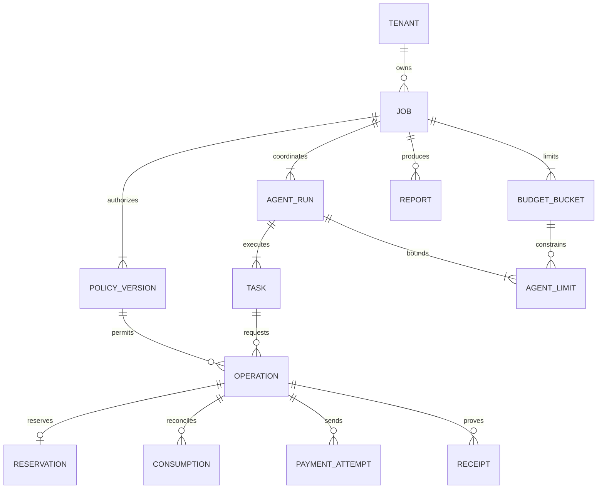

# Modelo de datos y persistencia

**Estado:** especificación del MVP, revisada el 9 de octubre de 2026. No hay esquema desplegado, migraciones SQL ejecutadas ni reservas probadas. El repositorio contiene especificaciones; no hay implementación de esta persistencia. Complementa [arquitectura](architecture.md), [backend](backend-and-agents.md) y [pagos](payments-and-budget.md).

## Decisión inicial y alternativas

Se recomienda **SQLite en el mismo host que una sola instancia del backend**, con archivos de entrada e informes en almacenamiento local privado. Dos agentes hacen trabajo de red concurrente, pero no necesitan dos escritores simultáneos. SQLite permite lectores concurrentes y una sola transacción de escritura; `BEGIN IMMEDIATE` permite obtener el turno de escritura antes de comprobar y reservar presupuesto. Las llamadas externas ocurren después del commit. [Transacciones de SQLite](https://www.sqlite.org/lang_transaction.html).

| Opción | Decisión y condición de cambio |
| --- | --- |
| SQLite | Inicial: un proceso de aplicación, dos agentes, transacciones cortas y volumen persistente local. Simplifica instalación y recuperación de la demostración. |
| PostgreSQL | Siguiente opción si se requieren varias instancias, alta disponibilidad o la espera de escritores incumple el objetivo medido. Su operación añade servidor, conexiones, backup y credenciales; no aporta valor inmediato a dos agentes. Una migración debe probar SQL, bloqueos y restauración, no limitarse a cambiar un driver. |
| MongoDB | Descartado: trabajos, autorizaciones, reservas y consumos tienen relaciones e invariantes transaccionales explícitas. No existe necesidad documental que compense un segundo modelo de almacenamiento. |
| Redis | Descartado: la cola inicial son estados persistidos; no se requiere caché compartida ni coordinación distribuida. No usar RAM como fuente de verdad del dinero. |
| Neo4j | Descartado: el flujo tiene dos tareas conocidas y no requiere consultas de recorridos arbitrarios. Un grafo de documentación no convierte el dominio transaccional en una base de grafos. |

SQLite recomienda un motor cliente/servidor ante múltiples servidores o escritores que no puedan esperar; el tamaño del proyecto por sí solo no exige el cambio. [Criterios oficiales de uso](https://www.sqlite.org/whentouse.html). PostgreSQL permitiría defensa adicional con RLS; debe configurarse expresamente, con rol de aplicación sin `BYPASSRLS` y sin ser propietario, pues esos roles pueden omitir las políticas. RLS no reemplazaría las comprobaciones del backend. [Políticas por fila](https://www.postgresql.org/docs/current/ddl-rowsecurity.html).

Versiones observadas en fuentes oficiales durante esta revisión: **SQLite 3.54.0**, publicado el 09-10-2026, y **PostgreSQL 18.6**, última menor de la rama estable 18 que muestra su tabla de soporte. No están instaladas por esta tarea ni prueban compatibilidad del driver. Al implementar se registrarán versión npm, `SELECT sqlite_version()` y plataforma reales. Las compilaciones SQLite deben incluir la corrección de WAL-reset: 3.51.3 o posterior, o un backport oficial documentado. [SQLite releases](https://www.sqlite.org/changes.html), [WAL y corrección](https://www.sqlite.org/wal.html), [soporte PostgreSQL](https://www.postgresql.org/support/versioning/).

## Fuentes de verdad

| Información | Autoridad y reconciliación |
| --- | --- |
| Responsable, sesión y pertenencia del trabajo | Backend/SQLite. Una dirección de wallet no autentica una sesión por sí sola. |
| Alcance y política autorizados | Snapshot inmutable en SQLite, digest, versión, responsable y fecha. La política contractual, si se demuestra integrada, es otra restricción efectiva y se contrasta con ese snapshot. |
| Tareas y entregables | SQLite conserva estado y metadatos; el almacén privado conserva bytes y digest. El coordinador puede reconstruir pendientes desde esos registros. |
| Reservas y disponibilidad para nuevas operaciones | Registro transaccional del broker en SQLite. No se infieren del saldo de una wallet. |
| Liquidación Stellar | Resultado confirmado de red y evidencia verificable de transferencia. SQLite guarda una proyección conciliada, con red, hash, posición de transferencia e instante de consulta. Una respuesta HTTP aislada no basta para resolver contradicciones. |
| Facturación del modelo | Consumo identificable reportado por el proveedor y su conciliación. Estimación y reserva locales no certifican la factura. |
| Entrega del servicio A/B | Respuesta validada y persistida, separada de la liquidación. Pagar no acredita haber recibido un resultado útil. |

No se publican código, prompts, informes ni identificadores personales en blockchain. Los identificadores internos son opacos, generados por servidor; su imprevisibilidad no sustituye autorización.

## Modelo lógico

Todas las tablas de negocio incluyen `tenant_id`, tiempos UTC y, cuando cambia su estado, `version`. En el MVP un tenant corresponde al responsable de la demostración; no hay equipos, membresías ni CRUD público de usuarios. Una segunda identidad sintética se utiliza en pruebas de aislamiento. Los catálogos globales son de solo lectura para el cliente.

| Entidad / propietario | Campos y relaciones principales | Restricciones |
| --- | --- | --- |
| `principals`, `tenants` / identity | Identidad del responsable preconfigurado y tenant propio. Referencia al verificador de credencial en configuración segura. | Un principal propietario por tenant MVP. Sin contraseñas ni claves en tablas de negocio o Git. |
| `sessions` / identity | Hash del token, principal, tenant, expiración, última actividad y revocación. | Token aleatorio opaco; unicidad de hash; consulta de sesión siempre exige vigencia. |
| Recuperaciones / identity | Hash del token, principal, creación, expiración, consumo y versión de credencial. | Uso único; 30 min propuestos; cambio/consumo atómicos y revocación de sesiones. |
| Notificaciones propias | Tenant/principal, evento de origen, texto público, enlace y fecha de lectura. | Dedupe por destinatario/evento; lectura no altera negocio. |
| Preferencias / identity | Zona y notificaciones internas del responsable. | Sin secretos o administración de terceros. |
| `wallet_challenges` / identity, condicional | Tenant/principal/sesión, cuenta pública G, red, dominio configurado, nonce aleatorio, esquema/digest del mensaje, creación, expiración y consumo. | Nonce criptográfico de 32 bytes y un uso; vigencia de 10 minutos; FK al contexto de sesión. El servidor fija dominio/red/contexto y verifica la firma de bytes exactos. No es autorización financiera. |
| `wallet_bindings` / identity, condicional | Tenant/principal, cuenta pública G, red, desafío verificado, fecha y revocación. | `UNIQUE(tenant_id,principal_id,network,public_key)`; desafío propio y consumo atómico con inserción del vínculo. Demuestra posesión para la aplicación, sin delegar fondos ni autenticar otras sesiones. |
| `jobs` / jobs | Objetivo, criterios, paquete `static-review`, digest de entrada, estado, política vigente, plazo, cancelación y propietario. | `UNIQUE(tenant_id,id)`; propietario perteneciente al tenant; revisión optimista por `version`. Edición solo antes de ejecución/compra; invalida la política vigente sin borrar su historial. |
| `input_files` / jobs | Job, nombre de presentación, tipo, bytes, líneas, digest y clave privada de almacenamiento. | Hasta 3 archivos/1.000 líneas/256 KiB por trabajo; nombres normalizados únicos; no aceptar rutas físicas del cliente. |
| `policy_versions` / budgets | Job, número, estado `draft/authorized/superseded`, digest, `input_digest`, modo single-pass/two-role, roles fijos, expiración, límites de ejecución y snapshot de proveedores. | `UNIQUE(tenant_id,job_id,revision)`; contenido autorizado inmutable; nueva aceptación para ampliaciones o cambio de variante antes de ejecutar. |
| `authorizations` / budgets | Job, versión de política, principal, digest aceptado, instante, modalidad de control y referencia de prueba wallet si aplica. | Una aceptación válida por versión; referencias compuestas al mismo tenant y job. No almacenar una clave privada. |
| `budget_buckets` / budgets | Job, categoría, `currency_key`, escala y límite autorizado vigente. | `UNIQUE(tenant_id,job_id,category,currency_key)`; categorías y activos no se mezclan. Historial de límites en políticas. |
| `agent_runs` / execution | Job, rol `reviewer` para single-pass o `analyst/test-designer` para two-role, versión de prompt, modelo/configuración fijados y resultado. | `UNIQUE(tenant_id,job_id,role)`; validar el conjunto exacto de roles de la política, sin mezclar variantes. Los roles no son usuarios ni fondos propios. |
| `agent_limits` / budgets | Agente, bolsa, tope de importe, llamadas, tokens y plazo. | `UNIQUE(tenant_id,job_id,agent_run_id,bucket_id)`; referencias compuestas evitan otro job/tenant. |
| `tasks` / execution | Agente, fase, estado, intento, `next_attempt_at`, inicio/fin y motivo. | Una o dos tareas según variante autorizada y fases de consolidación conocidas; límites de intentos persistidos antes de llamar. |
| `providers`, `provider_revisions` / providers | Catálogo A/B y modelo; herramienta, URL/método, red, activo, destino, precio/configuración y digest de revisión. | Administración fuera del modelo; revisión usada por una política no se sobrescribe. A/B tienen destinos distintos. |
| `operations` / payments o providers | Job, agente, tarea, bolsa, tipo `x402/model/network_fee`, clave lógica, digest de entrada/cotización, revisión autorizada y estados financiero/de entrega. | `UNIQUE(tenant_id,job_id,logical_key)`; mismo identificador con otro payload se rechaza. Clave compuesta adicional `(tenant_id,job_id,id,bucket_id,agent_run_id)` para referencias de reserva/consumo. |
| `reservations` / budgets | Operación, importe reservado, estado `open/captured/released`, timestamps y motivo. | `UNIQUE(tenant_id,job_id,operation_id)`; importe positivo; solo una transición terminal. |
| `consumptions` / budgets | Operación, importe confirmado, referencia de evidencia, tokens reportados si aplica. | Un cargo primario por operación; una corrección es una entrada separada, justificada y ligada al original. Nunca duplicar por reconsulta. |
| `payment_attempts` / payments | Operación, intento, digest de autorización, material de recuperación cifrado, expiración y estado de envío. | Identidad estable de autorización; intentos no crean compras nuevas. Material firmado no se expone al navegador/modelo/logs. |
| `receipts` / payments | Operación, red, hash, identificador de transferencia, activo, importe, pagador/destino y ledger. | Unicidad de `(network,transaction_hash,transfer_index)` cuando existe evidencia; no basta hash de transacción si incluye varias transferencias. |
| `job_events` / execution | Job, secuencia, tipo, operación/tarea opcional, actor y detalle sanitizado. | `UNIQUE(tenant_id,job_id,sequence)`; anexar eventos, sin prompts/código/secretos. |
| `reports` / reports | Job, versión, digest, estado `partial/complete`, referencias a hallazgos/recibos y clave de almacenamiento. | `UNIQUE(tenant_id,job_id,revision)`; un informe puede quedar listo mientras la conciliación financiera sigue pendiente. |
| `idempotency_requests` / infraestructura HTTP | Tenant, actor, método/ruta canónica, clave, digest, estado, recurso y respuesta sanitizada. | Unicidad del ámbito anterior; registro y mutación en la misma transacción. |

El diagrama muestra cardinalidades del trabajo configurado; un borrador puede no tener todavía política, bolsas ni agentes. No prescribe un ORM ni un microservicio por tabla.

Desafíos/vínculos de wallet solo se habilitan cuando el modo de demostración requiere esa prueba y su esquema de firma/verificación está demostrado. Las cuentas C y la autoridad contractual se prueban por el flujo financiero separado; no se atribuye a una cuenta C la firma Ed25519 directa de una cuenta G. Los desafíos caducados/usados pueden eliminar su nonce/mensaje en la limpieza diaria; se conserva el digest y metadatos de prueba del vínculo mientras se use y durante la retención de las autorizaciones que lo referencian. La firma de vinculación nunca se transmite a la red como pago.

Editar un trabajo mediante PATCH exige `If-Match`, ownership, estado `draft/awaiting_authorization` y ausencia de ejecución admitida, operaciones, reservas o consumos. Una transacción vuelve a comprobar esas precondiciones, sustituye los campos admitidos, incrementa `version`, calcula el digest de objetivo/criterios/archivos y deja el trabajo en `draft`. Toda política/aceptación anterior queda histórica e inutilizable para iniciar; no se cambia su contenido firmado/aceptado. Se requiere crear y autorizar un snapshot nuevo antes de ejecutar. Una carrera entre editar e iniciar solo admite una de las transiciones.

## Aislamiento y restricciones efectivas

El contexto `{principalId,tenantId}` nace de la sesión validada. El cuerpo, la query, una wallet y la salida del modelo no pueden seleccionarlo. Los repositorios reciben ese contexto obligatoriamente y buscan por `(tenant_id,job_id,resource_id)`. Un join incluye tenant y job en ambos lados; se autorizan también recibos, eventos, archivos e informes. Recurso ajeno e inexistente devuelven el mismo 404.

Cada padre tiene una clave única compuesta adecuada; cada hijo de trabajo repite `tenant_id` y `job_id` en su FK, por ejemplo `(tenant_id,job_id,agent_run_id)`. Sesiones y pruebas de wallet usan su ámbito compuesto tenant/principal/sesión. Estas restricciones impiden insertar referencias de otro propietario o trabajo aunque el backend reciba un ID existente. **Las FK impiden relaciones inválidas, pero no filtran lecturas:** ambas defensas son obligatorias. Activar y verificar `PRAGMA foreign_keys=ON` en cada conexión; SQLite no garantiza su activación por omisión. [SQLite foreign keys](https://www.sqlite.org/foreignkeys.html).

Tablas `STRICT` y `CHECK` para enum, enteros no negativos, escala admitida y fechas coherentes. Las invariantes entre varias filas —sumas, cupos, pertenencia a política— se comprueban en el caso de uso dentro de la transacción; no se presume que un `CHECK` consulte otras filas. `ON DELETE RESTRICT` protege registros con cargos o reservas; eliminar contenido es una operación específica, no un cascade financiero.

Índices iniciales: `jobs(tenant_id,created_at,id)`; `tasks(state,next_attempt_at)` para el despachador interno; `operations(tenant_id,job_id,state)`; `operations(state,next_reconcile_at)`; `reservations(tenant_id,job_id,bucket_id,state)`; `consumptions(tenant_id,job_id,bucket_id)`; `job_events(tenant_id,job_id,sequence)` y `sessions(token_hash)`. `bucket_id` en reserva/consumo se valida mediante FK compuesta a la operación, para que no pueda apuntar a otra bolsa. Los índices globales de recuperación son exclusivos del proceso interno; nunca se exponen como listados globales de la API.

## Importes y reserva atómica

Dinero en JSON: `{ "currencyKey": "USD", "scale": 9, "minor": "1000000000" }` significa USD 1,00. Para un activo Stellar, `currencyKey` incluye red y contrato verificados; los decimales salen de sus metadatos, no del ticker. El ejemplo de Testnet con escala 7 usa `500000` para 0,05 y `300000` para 0,03. Estos números ilustran límites, no fijan tarifas.

En TypeScript se opera con `bigint`; en SQLite, `INTEGER` con lectura/escritura de 64 bits del driver. La API acepta cadenas decimales canónicas no negativas, sin exponente, separadores ni redondeo implícito. Cada importe/suma admitido tiene un máximo de `10^15` unidades mínimas; desbordamiento se rechaza antes del SQL. Los precios fraccionarios de modelos se mantienen como razones decimales exactas; la reserva se redondea hacia arriba a nanoUSD después de incluir todas las categorías facturables. No usar `Number`, `REAL` ni conversiones de divisas implícitas para contabilizar.

Para cada bolsa y agente se calcula desde reservas abiertas y consumos conciliados:

`saldoNeto = autorizado − confirmado − reservado`

El saldo interno puede ser negativo ante un cargo externo inesperado. La API serializa `available = max(0, saldoNeto)` y `deficit = max(0, −saldoNeto)` como cadenas enteras no negativas, en la misma escala/moneda. Así `available` nunca contradice el DTO y el déficit permanece visible; no se reduce `confirmed` para corregirlo. Una bolsa/agente con déficit o incidente `over_limit` no admite nuevas reservas.

El cupo del agente restringe el mismo gasto de la bolsa: no añade saldo ni genera un segundo cargo. Cupos de 0,03 para ambos agentes pueden competir por una bolsa global de 0,05. No hay dos libros duplicados ni contadores de RAM autoritativos.

La operación de reserva debe ejecutarse así:

1. Validar formato y resolver proveedor/herramienta desde el catálogo; obtener cotización fuera de transacción sin firmar ni pagar.
2. Abrir `BEGIN IMMEDIATE`; si está ocupado, esperar/reintentar de forma acotada. No enviar nada mientras no exista commit.
3. Buscar la clave lógica. Si ya existe y su digest coincide, devolverla; si difiere, rechazar. Revalidar tenant, estado del trabajo, cancelación, versión y vigencia de autorización, red, activo, método, destino, precio y cuotas de llamadas/tokens.
4. Sumar reservas abiertas y consumos confirmados de la bolsa y del agente. Verificar máximo por operación y disponibilidad de ambos. Insertar operación, reserva y evento en la misma transacción. Si hay varias bolsas necesarias, reservar todas en esa misma transacción o ninguna.
5. Commit. Solo después preparar firma/solicitud y persistir su identidad y estado antes del primer envío. La cotización y la autorización se revalidan de nuevo si han vencido antes de firmar.

Una colisión de clave o un error causa rollback completo. Política, autorización, cancelación y reserva usan la misma serialización transaccional, de modo que dos peticiones de 0,03 por una bolsa de 0,05 no pueden aprobarse ambas. No se hacen HTTP, RPC, inferencias ni escrituras de archivos lentas con el bloqueo abierto.

Capturar una reserva exige prueba del cargo definitivo: en una sola transacción se inserta consumo idempotente y se marca `captured`. Si el cargo definitivo es menor, se libera la diferencia. Un consumo reportado todavía provisional se guarda como observación de la operación y conserva la reserva completa hasta conocer el total; no se suma como gasto confirmado. Liberar exige evidencia de que no habrá cargo y que ninguna autorización entregada puede liquidarse. Timeout, cancelación, reinicio y vencimiento del trabajo no son esa evidencia.

La factura real de un modelo podría contradecir la cota prevista. Debe registrarse completa, marcar `over_limit`, bloquear nuevos consumos y mostrar el déficit, aunque rompa la expectativa `confirmado + reservado <= autorizado`. No reducir ni descartar un gasto verdadero para hacer coincidir un límite. Es un incidente del adaptador/presupuesto que requiere conciliación; no autoriza una recarga.

## Idempotencia y recuperación

La clave HTTP idempotente pertenece a tenant, actor y ruta; repetirla con el mismo cuerpo devuelve el recurso ya creado. Se conserva por al menos 24 horas y mientras su operación siga sin resolver. Además, la unicidad de compra lógica vive durante toda la retención del trabajo, de modo que expirar la respuesta HTTP no permite cobrar de nuevo. Un nuevo intento técnico conserva operación, cotización y autorización; un payload incompatible devuelve conflicto.

Se persisten por separado `financialState` y `deliveryState`. `confirmed/failed` es válido: hubo pago, falló la entrega. El reinicio examina operaciones `prepared/submitted/uncertain`, consulta proveedor/facilitator/red y continúa la misma conciliación. Una autorización firmada con resultado de envío desconocido conserva reserva. No se reejecuta una llamada de modelo de resultado incierto si el proveedor no permite consultar o garantizar idempotencia del cargo. Los recibos y respuestas se deduplican por evidencia estable.

El almacén de archivos escribe primero un temporal dentro del directorio privado, calcula digest y renombra de forma atómica; después persiste la referencia. Temporales huérfanos se limpian mediante un barrido. Una referencia cuyo archivo falta se marca como no disponible y no se inventa un informe.

Restaurar un backup puede retroceder SQLite respecto de la red y de la factura del modelo. El backend arranca con **bloqueo global de nuevas reservas, firmas e inferencias pagadas**. La recuperación debe enumerar el intervalo completo entre la copia y el incidente: cuentas pagadoras creadas, autoridades delegadas/autorizaciones aún utilizables, compras, liquidaciones y llamadas/facturas de modelos, inclusive trabajos ausentes de la copia. Se contrasta la cobertura con inventario de cuentas/credenciales y evidencia externa recuperable; revisar solo filas `uncertain` presentes en el backup no es suficiente. Una consulta sin resultados tampoco prueba que el intervalo esté cubierto.

Si se desconoce una cuenta, operación o factura potencialmente posterior, o las fuentes no permiten reconstruir esa ventana, el bloqueo sigue siendo **global**, no solo del trabajo conocido. El operador registra la falta de evidencia; documentar el incidente, vencer un TTL o restaurar secretos no habilita gasto. El procedimiento de recuperación debe demostrar cobertura y conciliar obligaciones antes de levantar el bloqueo. La disponibilidad no se garantiza si esa evidencia se perdió; el RPO operativo no autoriza perder trazabilidad financiera.

## Operación, retención y migraciones

La base viva y sus archivos WAL/SHM deben estar en un directorio de datos configurable **fuera del repositorio sincronizado con OneDrive**, fuera de carpetas públicas y fuera de unidades de red. SQLite WAL requiere procesos en un mismo host; se recomienda WAL, `synchronous=FULL`, timeout de bloqueo acotado y lectura breve, sujetos a verificación del driver. La recomendación de evitar sincronizadores de archivos para una base viva es una decisión de operación del proyecto. [WAL oficial](https://www.sqlite.org/wal.html).

| Datos | Retención inicial propuesta para la demo |
| --- | --- |
| Código de entrada y respuestas de proveedores/modelos | 7 días desde cierre; eliminación anticipada autorizada tras detener uso. Se informa al usuario de su eliminación y de cualquier copia externa sujeta a política del proveedor. |
| Informe final o parcial | 30 días desde cierre; puede contener fragmentos mínimos de evidencia. Se elimina también al atender la eliminación anticipada de contenido. |
| Prompts completos y cadena de razonamiento | No se registran por defecto; solo configuración/prompt versionado y evidencia final necesaria, sin razonamiento privado. |
| Eventos sanitizados y logs operativos | 14 días; nunca cuerpo de código, cookies, firmas reutilizables o secretos. |
| Política, reservas, cargos y recibos Testnet | 90 días tras cierre financiero. Operación incierta conserva metadatos mínimos hasta resolución; revisión operativa a los 7 días, sin liberar automáticamente fondos. |
| Sesiones | Caducidad absoluta de 12 h e inactividad de 30 min; revocación inmediata al salir. Limpieza diaria de expiradas. |
| Backups cifrados | Ventana móvil de 7 días; la eliminación completa de contenido puede tardar esa ventana. No se restaura un backup sin reaplicar solicitudes de eliminación registradas. |

Estos plazos son decisiones de producto de la demostración, no obligaciones legales ni garantías del proveedor. Una futura operación comercial debe definir su política con los interesados antes de recibir código privado.

Migraciones SQL numeradas y versionadas en la infraestructura de datos del backend; una tabla `schema_migrations(version,checksum,applied_at)` detecta cambios de archivos ya aplicados. Un único proceso migra antes de aceptar tráfico; hacer backup consistente, comprobar integridad/FK y ensayar restauración. No copiar solo el `.db` abierto ignorando WAL. La implementación elegirá la API de backup soportada por el driver. Cambios destructivos requieren exportación/retención explícita y migración hacia adelante; un rollback de esquema no revierte un pago.

Orden lógico: (1) identidad/jobs/archivos, (2) políticas/bolsas/límites, (3) operaciones/reservas/consumos, (4) ejecución/eventos/reportes y recuperación. Las pruebas deben cubrir creación desde cero, actualización de una base anterior y conservación de datos. Hoy no hay datos de aplicación que migrar.

## Evidencia necesaria y dependencias pendientes

| Verificación futura | Resultado exigido |
| --- | --- |
| Dos reservas simultáneas y dos conexiones reales | Una sola de 0,03 aceptada con tope 0,05; ningún side effect del intento rechazado. |
| Ownership de recursos anidados | Cambiar job, agente, archivo o recibo a otro tenant falla incluso con IDs válidos; una FK cruzada también falla. |
| Edición concurrente y prueba de wallet | Editar invalida el snapshot anterior; editar/iniciar no ganan ambos. Una firma de otro tenant/dominio/red, caducada o repetida no vincula una wallet ni autoriza gasto. |
| Duplicado y reinicio en cada límite de commit/envío | Una compra lógica, ningún cargo duplicado, reserva incierta preservada. |
| Conversión exacta y límites | Escalas, máximos, precio fraccionario y rechazo de exponentes/overflow sin pérdida de precisión. |
| Backup y eliminación | Restauración verificable, conciliación previa al gasto y contenido eliminado que no reaparece. Un trabajo/pago creado después del backup y ausente de él impide reanudar gasto global hasta reconstruir la ventana, incluidas facturas de modelos. |

Pendientes: elegir y probar el driver SQLite con Node LTS; fijar motor realmente embebido; verificar activo/escala; demostrar identidad y evidencia de liquidación x402; elegir un proveedor de modelos con cota de costo y consulta de uso suficientes. PostgreSQL, ORM y colas externas no son dependencias del MVP.

## Extensiones de experiencia del 10-10-2026

Correo preconfigurado verificado por canal confiable; verificador mutable de contraseña en almacén seguro de identidad, fuera de Git y tablas de negocio. Recuperación autoservicio sustituye el mecanismo exclusivo de operador; almacenamiento y entrega de correo siguen pendientes.

Archivar será un indicador con fecha y versión independiente de ejecución/situación financiera. No borra contenido ni contabilidad; lo incierto sigue rastreable. Eliminar directamente un borrador exige ausencia de ejecución, reservas, operaciones y consumos. Revisiones ejecutadas siguen la retención definida.

Notificaciones internas derivadas de eventos propios persistidos, sin tareas de agentes ni nuevas autorizaciones. Marcado y preferencias idempotentes; no envío de correo por defecto. Abrir enlaces revalida el recurso.

## Contextos separados de política

La política de revisión estándar contiene USD 1,00 para modelo y límites externos USDC/XLM cero, no autorizados. DEMO-01 de integración pública contiene otra identidad, pricing.ts fijo, aceptación Testnet propia y bolsas separadas USD 1,00 / USDC Testnet 0,06 / XLM Testnet 0,10.

El tipo de contexto y fixture permitido se validan contra configuración confiable; una coincidencia de nombre o digest no habilita A/B en un trabajo privado. Reservas, eventos e informes se vinculan al contexto y trabajo de origen. Variables Figma de avisos o borrador no sustituyen estos registros ni demuestran persistencia.
